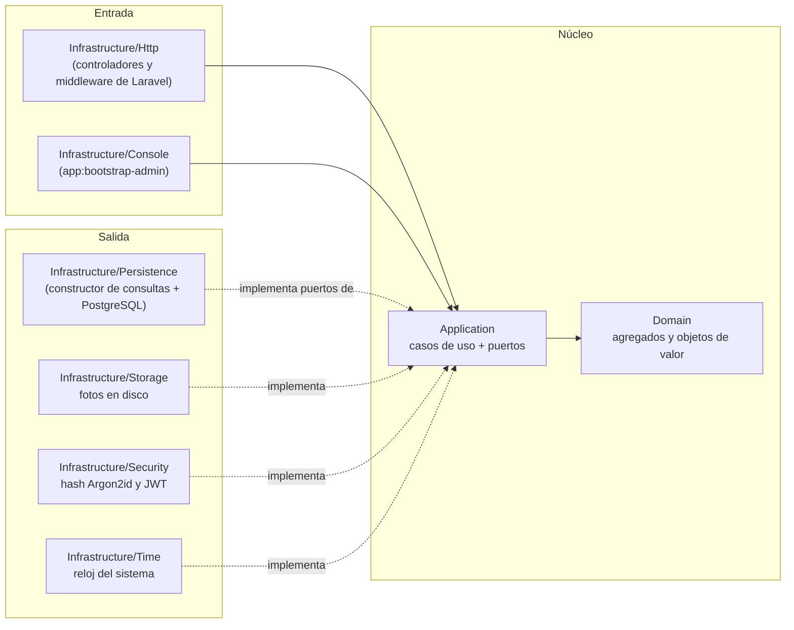
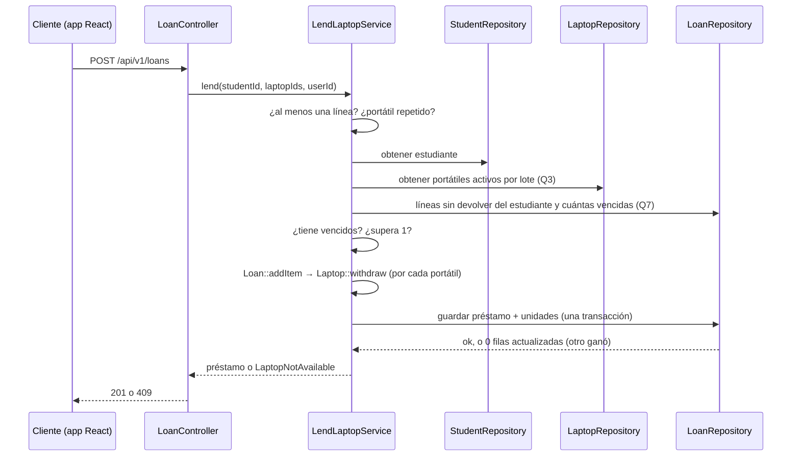

# Arquitectura — Préstamo de portátiles (Laravel + React)

Arquitectura **hexagonal** (puertos y adaptadores) en el backend. Las reglas de dependencia son los artículos I a III de
[`constitution.md`](constitution.md).

## 1. Capas y dependencias



Las flechas de dependencia apuntan **hacia adentro**. `app/Providers/PortBindingsServiceProvider.php` es el único que ve las dos mitades.

## 2. Estructura de carpetas (`api/`)

```text
app/
├── Domain/                    # Laptop, Loan, LoanItem, Student, User, Category; ModelCode, Quantity,
│   │                          # DocumentNumber, DateRange, Role, LoanStatus
│   └── Exceptions/            # LaptopNotAvailable, StudentHasOverdue, StudentLimitExceeded, …
├── Application/
│   ├── Ports/                 # LaptopRepository, LoanRepository, StudentRepository, UserRepository,
│   │                          # CategoryRepository, MostRequestedReportReader, Clock, PasswordHasher,
│   │                          # TokenIssuer, PhotoStorage, TransactionRunner, IdGenerator
│   └── Services/              # LoginService, CreateAssistantService, ListCategoriesService, CreateLaptopService,
│                              # UpdateLaptopService, RetireLaptopService, SearchLaptopsService, LaptopPhotoService,
│                              # CreateStudentService, SearchStudentsService, LendLaptopService, ReturnItemService,
│                              # ListLoansService, OverdueService, MostRequestedReportService
├── Infrastructure/
│   ├── Http/                  # Controllers/, Middleware/ (Authenticate, RequireRole), ErrorRenderer, Presenters
│   ├── Console/               # BootstrapAdminCommand
│   ├── Persistence/           # DbLaptopRepository, DbLoanRepository, DbStudentRepository, DbUserRepository,
│   │                          # DbCategoryRepository, DbMostRequestedReportReader, DbTransactionRunner,
│   │                          # RandomUuidGenerator, SqlValues (UTC, uuid y comodines de ILIKE)
│   ├── Security/              # Argon2PasswordHasher, JwtTokenIssuer
│   ├── Storage/               # DiskPhotoStorage
│   └── Time/                  # SystemClock
└── Providers/
    └── PortBindingsServiceProvider.php   # único punto de composición
database/migrations/            # esquema, tablas, restricciones y semilla de categorías
routes/api.php                  # las 21 rutas del contrato
config/laptops.php              # JWT_SECRET, PHOTOS_DIR, CLOCK_OFFSET_DAYS, ADMIN_*, CORS_ORIGIN (solo del entorno)
tests/{Unit/Domain, Unit/Application, Feature, Architecture, Fakes, Support}
```

El frontend (`app/`) se organiza por pantalla: `src/pages/` (Login, Laptops, Students, Lend, LoanDetail, Overdue, Report, Assistants),
`src/api/client.js` (único lugar que llama a la API) y `src/auth/` (token y rol en memoria y `sessionStorage`).

## 3. Agregados

| Raíz | Contiene | Invariantes que defiende |
|---|---|---|
| `Laptop` | `ModelCode`, unidades totales y disponibles, baja lógica | disponibles entre 0 y total; total ≥ 1; nombre no vacío |
| `Loan` | colección de `LoanItem` | al menos 1 línea; sin portátil repetido; vencimiento a 15 días; inmutable salvo devolución |
| `Student` | `DocumentNumber` | documento obligatorio |
| `User` | `Role`, hash | nombre normalizado; rol en (`admin`, `assistant`) |

`Loan::addItem()` llama a `Laptop::withdraw()` antes de añadir la línea: descontar la unidad y crear la línea son **una sola
operación**. `Loan::returnItem()` llama a `Laptop::restock()` una sola vez por línea.

## 4. Flujo: registrar un préstamo



El orden de las comprobaciones es el del contrato (§3.6): forma, repetido, inexistente, vencidos, límite y unidades.
`tests/Unit/Application/LendLaptopServiceTest.php` prueba cada par vecino de ese orden.

**Devolución.** `ReturnItemService` marca la línea y el repositorio la guarda solo si sigue sin devolver
(`WHERE returned_at IS NULL`); la unidad se suma con un incremento atómico que nunca pasa del total. Así, dos auxiliares
devolviendo la misma línea a la vez suman **una** unidad y el segundo recibe `ITEM_ALREADY_RETURNED`.

**Orden de los listados.** Portátiles y estudiantes se ordenan por nombre **sin distinguir mayúsculas** y luego por `id`,
para que la paginación sea estable.

## 4.1 Fakes de prueba

`tests/Fakes/` tiene una implementación en memoria de cada puerto. Guardan **copias** (un servicio que falla a mitad no
deja rastro) y reproducen la escritura condicional de ADR-002, de modo que las pruebas de aplicación ejercen también la
carrera por la última unidad. `InMemoryApplication` arma los servicios con esos fakes solo para las pruebas.

## 5. Errores

El dominio y la aplicación lanzan excepciones propias (`LaptopNotAvailable`, `StudentHasOverdue`, `StudentLimitExceeded`, …), todas
hijas de `App\Domain\Exceptions\DomainError` con su `code`. **Solo** el adaptador HTTP (`Infrastructure/Http/ErrorRenderer.php`,
registrado en `bootstrap/app.php`) las traduce al cuerpo único y al código de estado de [`api-contract.md`](api-contract.md).
Un error del framework (validación, 404 de ruta, 500) también pasa por ese renderizador y nunca llega al cliente con su forma original.

## 6. Qué no hay

Sin eventos, sin colas, sin caché, sin microservicios, sin multi-sede. Se añaden si un requisito lo pide, no antes.
