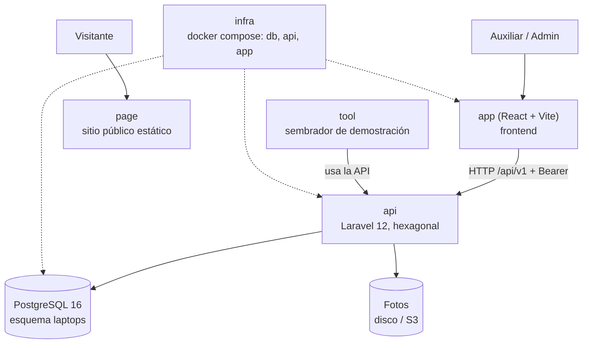

# Arquitectura en una página — Préstamo de portátiles

Para leer en cinco minutos antes de abrir el resto. El detalle está en [`architecture.md`](architecture.md).

## El sistema en una imagen

## Las seis carpetas y su papel

| Carpeta | Papel | Se prueba con |
|---|---|---|
| `docs` | La especificación | Que esta lectura baste para construir |
| `api` | Reglas de negocio y contrato HTTP | Pruebas de dominio, aplicación, contrato, arquitectura y concurrencia |
| `app` | Pantallas de operación | Un recorrido de punta a punta: login → prestar → devolver → vencidos → reporte |
| `page` | Presentación pública, sin llamar a la API | Que se vea bien en móvil y escritorio |
| `infra` | `docker compose up` y la base vacía | Que arranca con un solo comando |
| `tool` | Datos de demostración (portátiles, estudiantes, préstamos) | Que la demostración tenga datos reales |

## Las cinco ideas que sostienen el diseño

1. **El préstamo es un hecho inmutable**; solo cambia `returned_at` de una línea.
2. **Las unidades se descuentan y se devuelven dentro de la misma operación** que crea o cierra la línea.
3. **El estado se calcula**: `open`, `overdue` o `closed` no están en la base.
4. **Lo congelado no sigue al inventario**: el reporte de noviembre no cambia porque en diciembre se renombre un portátil.
5. **La base es la última barrera**: si el `CHECK` de unidades salta, algo escribió fuera del sistema.

## Qué cambia frente a un préstamo de libros

Un estudiante tiene como máximo **un** portátil sin devolver y lo tiene **15 días**. Por eso el límite y los vencidos se revisan
antes de cada préstamo, y la competencia por la última unidad (dos auxiliares entregando a la vez) es el caso de concurrencia
que más importa.
