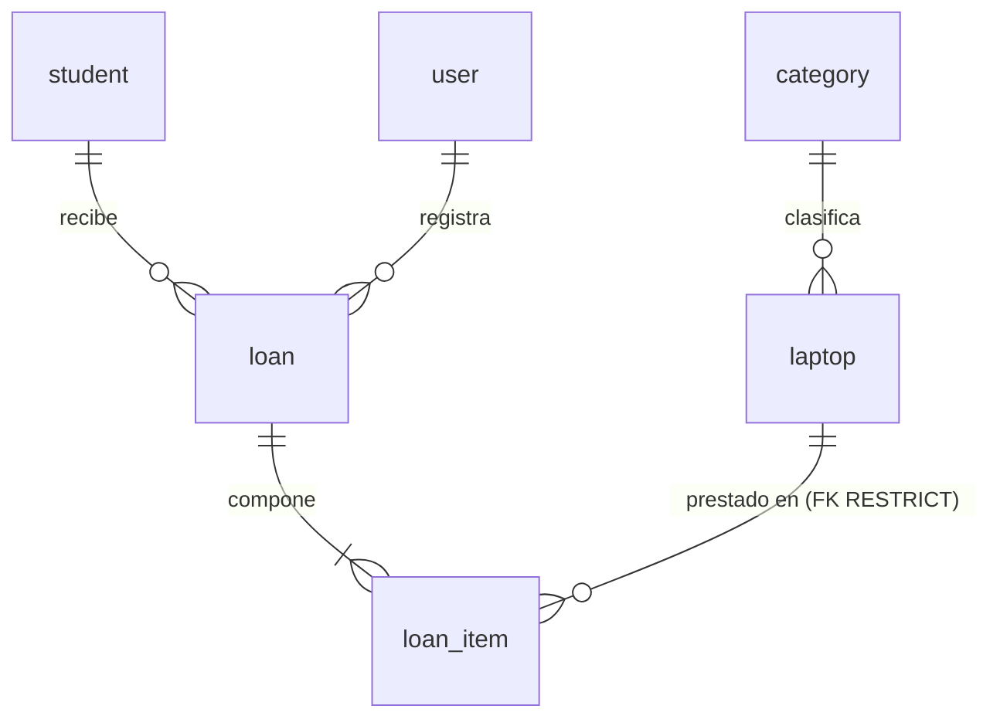

# Modelo de datos — Préstamo de portátiles

**El único sitio donde vive el modelo de datos.** Quien implemente no necesita abrir el código ni conectarse al motor para saber qué hay,
de qué tipo y con qué regla.

- Motor: PostgreSQL 16. Esquema `laptops`. Servidor en UTC.
- Rige bajo [`constitution.md`](constitution.md) y [`spec.md`](spec.md). Si algo contradice a este documento, gana este documento.
- El DDL lo escriben las migraciones de Laravel (`api/database/migrations/`), nunca `infra` ([ADR-001](adr/adr-001-propiedad-del-esquema.md)).

Cada regla lleva una de **tres marcas**: **motor** (la impone la base), **solo dominio** (solo el código),
**pendiente (T-xx)** (la pone esa tarea de [`tasks.md`](tasks.md)).

---

## 0. Convención de nombres

| Elemento | Convención | Ejemplo |
|---|---|---|
| Tabla | `snake_case`, inglés, **singular** | `loan_item` |
| Columna | `snake_case`, inglés, singular, ASCII | `due_at` |
| Restricción escrita a mano | `ck_{tabla}_{regla}` | `ck_laptop_available_range` |
| Esquema | `laptops` | `laptops.loan` |

`user` se escribe `laptops."user"` en SQL a mano; el constructor de consultas de Laravel lo entrecomilla solo.

## 1. Glosario

| Término | Definición | Dónde vive |
|---|---|---|
| **Portátil** | Modelo del inventario, con nombre, marca, código de modelo, categoría, unidades y foto opcional | `laptop` |
| **Código de modelo** | Identificador comercial del modelo (p. ej. `TP-E14-G5`). Es al portátil lo que el ISBN al libro | `laptop.model_code` |
| **Categoría** | Clasificación fija de cinco, sembrada, sin mantenimiento | `category` |
| **Unidad** | Equipo físico de un modelo. Se cuenta, no se identifica | `laptop.total_units`, `laptop.available_units` |
| **Estudiante** | Persona que recibe el préstamo. No inicia sesión | `student` |
| **Préstamo** | Hecho consumado: quién lo recibió, quién lo registró y cuándo | `loan` |
| **Línea de préstamo** | Un portátil dentro de un préstamo, con su vencimiento y su devolución | `loan_item` |
| **Estado del préstamo** | `open`, `overdue` o `closed`. **Se calcula, no se almacena** | sin columna |
| **Usuario** | Operador interno con rol `admin` o `assistant` (auxiliar) | `user` |
| **Congelado** | Copia del valor en el instante del préstamo; no sigue al inventario | `loan_item.laptop_name`, `model_code`, `category_name` |

## 2. Entidades y relaciones



Seis entidades, seis tablas. No hay tabla de reporte, de multas, de reservas ni de auditoría.

La única tabla adicional es la que Laravel usa para registrar qué migraciones corrieron (`public.migrations`, fuera del esquema del negocio). No es parte del
negocio y no se consulta desde el código. Laravel no crea ninguna otra: el proyecto no usa sesiones, caché en base, colas ni tokens
persistidos (ver [`plan.md`](plan.md) D-11).

## 3. Modelo físico

Ninguna columna lleva `DEFAULT`: los valores los pone el dominio. Los identificadores son UUID v4 generados por la aplicación.

**`category`** — semilla de solo lectura.

| Columna | Tipo | Nulable | Nota |
|---|---|---|---|
| `id` | `uuid` | no | PK. Identificadores literales (ver §9) |
| `name` | `varchar(120)` | no | Único |

**`laptop`**

| Columna | Tipo | Nulable | Nota |
|---|---|---|---|
| `id` | `uuid` | no | PK |
| `name` | `varchar(200)` | no | Recortado por el dominio. Ej.: `ThinkPad E14 Gen 5` |
| `brand` | `varchar(120)` | no | Ej.: `Lenovo` |
| `model_code` | `varchar(20)` | no | Mayúsculas, dígitos y guion. Único entre portátiles activos (índice parcial) |
| `category_id` | `uuid` | no | FK restrictiva a `category` |
| `total_units` | `integer` | no | ≥ 1 |
| `available_units` | `integer` | no | Entre 0 y `total_units` |
| `photo_key` | `varchar(512)` | **sí** | Clave opaca; nunca ruta ni bytes; nunca cadena vacía |
| `deleted_at` | `timestamptz` | sí | Baja lógica. Nula = activo |

**`student`**

| Columna | Tipo | Nulable | Nota |
|---|---|---|---|
| `id` | `uuid` | no | PK |
| `full_name` | `varchar(200)` | no | |
| `document_number` | `varchar(30)` | no | Único |

**`loan`**

| Columna | Tipo | Nulable | Nota |
|---|---|---|---|
| `id` | `uuid` | no | PK |
| `student_id` | `uuid` | no | FK restrictiva a `student` |
| `loaned_by_user_id` | `uuid` | no | FK restrictiva a `user` |
| `loaned_at` | `timestamptz` | no | Instante del préstamo |

**`loan_item`**

| Columna | Tipo | Nulable | Nota |
|---|---|---|---|
| `id` | `uuid` | no | PK |
| `loan_id` | `uuid` | no | FK con `ON DELETE CASCADE` |
| `laptop_id` | `uuid` | no | FK restrictiva a `laptop` |
| `laptop_name` | `varchar(200)` | no | Congelado; mismo ancho que `laptop.name` |
| `model_code` | `varchar(20)` | no | Congelado |
| `category_name` | `varchar(120)` | no | Congelado; **sin FK a propósito** |
| `due_at` | `timestamptz` | no | `loaned_at` + 15 días, calculado por el dominio |
| `returned_at` | `timestamptz` | **sí** | Nula mientras no se devuelve |

**`user`**

| Columna | Tipo | Nulable | Nota |
|---|---|---|---|
| `id` | `uuid` | no | PK |
| `username` | `varchar(120)` | no | Único, minúsculas, recortado |
| `password_hash` | `varchar(512)` | no | Nunca se indexa |
| `role` | `varchar(40)` | no | `admin` o `assistant` |

Reglas transversales: **todas las marcas de tiempo son `timestamptz`**; **no hay columnas de auditoría** (`created_at`/`updated_at`)
porque ningún requisito las pide. En Laravel esto se traduce en no usar `$table->timestamps()` en ninguna migración.

## 4. Restricciones e índices: dónde vive cada regla

| Regla | Objeto | Marca |
|---|---|---|
| Claves primarias de las seis tablas | `*_pkey` | **motor** |
| `category.name` único | índice único | **motor** |
| `student.document_number` único | índice único | **motor** |
| `user.username` único | índice único | **motor** |
| `model_code` único entre activos | índice único parcial `WHERE deleted_at IS NULL` | **motor** |
| `laptop.category_id` → `category.id` RESTRICT | FK | **motor** |
| `loan.student_id` → `student.id` RESTRICT | FK | **motor** |
| `loan.loaned_by_user_id` → `user.id` RESTRICT | FK | **motor** |
| `loan_item.loan_id` → `loan.id` CASCADE | FK | **motor** |
| `loan_item.laptop_id` → `laptop.id` RESTRICT | FK | **motor** |
| `0 <= available_units <= total_units` | `ck_laptop_available_range` | **motor** — última barrera de concurrencia |
| `total_units >= 1` | `ck_laptop_total_positive` | **motor** (migración `2026_11_17_000001`, T-18) |
| Único `(loan_id, laptop_id)` | índice único | **motor** |
| `role` en (`admin`,`assistant`) | `ck_user_role` | **motor** (migración `2026_11_17_000001`, T-18) |
| Máximo 1 portátil sin devolver por estudiante | — | **solo dominio** (no expresable en un `CHECK` sobre una fila) |
| Estudiante con vencidos no recibe | — | **solo dominio** |
| Descontar la unidad y crear la línea son una operación | — | **solo dominio** (una transacción) |
| Un préstamo tiene al menos una línea | — | **solo dominio** |
| Préstamos y devoluciones inmutables salvo `returned_at` | — | **solo dominio** (por ausencia de operación) |

Índices de acceso: `laptop (category_id, name)` parcial sobre activos; `loan (loaned_at)`; `loan (student_id)`;
`loan_item (laptop_id)`; `loan_item (due_at) WHERE returned_at IS NULL` para vencidos.

## 5. Política de claves foráneas

| # | FK | `ON DELETE` | Por qué |
|---|---|---|---|
| FK-1 | `laptop.category_id` | RESTRICT | Una categoría con portátiles no se elimina |
| FK-2 | `loan_item.loan_id` | CASCADE | Composición: la línea no vive sin su préstamo (nunca se dispara: no se borran préstamos) |
| FK-3 | `loan_item.laptop_id` | RESTRICT | Barrera de última instancia: un borrado manual no puede dejar huérfano el histórico |
| FK-4 | `loan.student_id` | RESTRICT | El estudiante de un préstamo no desaparece |
| FK-5 | `loan.loaned_by_user_id` | RESTRICT | La autoría es un dato de control |

`ON UPDATE NO ACTION` en todas: las claves son UUID de la aplicación y no cambian.

## 6. Patrones de acceso

| # | Patrón | Frecuencia |
|---|---|---|
| Q1 | Buscar portátiles (texto, categoría, activos, orden por nombre, paginado) | Alta |
| Q2 | Portátil por id | Alta |
| Q3 | Portátiles por lote de ids (antes de prestar) | Alta, punto de contención |
| Q4 | Listar categorías | Alta |
| Q5 | Préstamo con sus líneas | Media |
| Q6 | Préstamos por rango, estado y estudiante | Alta |
| Q7 | Líneas sin devolver de un estudiante (cuenta y vencidos) | Alta, en cada préstamo |
| Q8 | Vencidos globales | Media |
| Q9 | Reporte: más solicitados por rango | Alta, la más costosa |
| Q10 | Usuario por nombre | Alta, en cada inicio de sesión |

## 7. Privacidad y retención

| Tabla | Atributo | Clasificación | Manejo |
|---|---|---|---|
| `user` | `username` | Dato personal | Acceso restringido |
| `user` | `password_hash` | **Secreto** | Jamás en logs ni respuestas; nunca se indexa |
| `student` | `full_name`, `document_number` | **Dato personal** (Ley 1581 de 2012) | Solo `admin` y `assistant`; **nunca** en el reporte ni en endpoints públicos |
| `loan`, `loan_item` | todos | Operativos; `student_id` es dato personal indirecto | Retención indefinida |
| `laptop`, `category` | todos | Públicos | Baja lógica / sin borrado |

El reporte agrega por portátil: **no expone estudiantes ni auxiliares**.

**Retención:** préstamos y líneas nunca se borran; portátiles solo baja lógica; el binario de la foto es el **único** dato que se borra
físicamente. Orden obligatorio: primero se anula `photo_key` y se confirma la transacción; después se borra el binario.

## 8. Auditoría

El sistema **no** lleva `created_at`/`updated_at`. Los instantes de negocio ya tienen columna: `loan.loaned_at`, `loan_item.returned_at`
y `laptop.deleted_at`. Si aparece una pregunta del tipo «¿quién cambió este nombre?», la decisión vuelve al propietario.

## 9. Estrategia de semilla

Las **cinco categorías** van en la migración inicial, con identificadores fijos:

| `id` | `name` |
|---|---|
| `11111111-1111-4111-8111-111111111111` | Básicos |
| `22222222-2222-4222-8222-222222222222` | Diseño |
| `33333333-3333-4333-8333-333333333333` | Programación |
| `44444444-4444-4444-8444-444444444444` | Tabletas |
| `55555555-5555-4555-8555-555555555555` | Accesorios |

El **administrador inicial no lo siembra la base**: lo crea el arranque de la aplicación (`php artisan app:bootstrap-admin`) con
`ADMIN_USERNAME` y `ADMIN_PASSWORD`, porque el hash solo puede producirlo el puerto de hash. El sembrador de datos de demostración
(`tool`) usa la **API**, nunca SQL directo.

## 10. Cómo se comprueba que este documento no miente

```sql
-- Debe devolver las columnas de §3, sin ningún DEFAULT
SELECT table_name, ordinal_position, column_name, data_type, is_nullable, column_default
FROM information_schema.columns WHERE table_schema = 'laptops' ORDER BY 1, 2;

-- Restricciones: PK, FK y CHECK
SELECT c.conrelid::regclass, c.conname, c.contype, pg_get_constraintdef(c.oid)
FROM pg_constraint c JOIN pg_namespace n ON n.oid = c.connamespace
WHERE n.nspname = 'laptops' ORDER BY 1, 3, 2;

-- Índices
SELECT tablename, indexname, indexdef FROM pg_indexes WHERE schemaname = 'laptops' ORDER BY 1, 2;
```

Se corren con `docker compose exec db psql -U laptops -d laptops -f /dev/stdin < check.sql` desde `infra/`.
Si una regla marcada **motor** no aparece, alguien la borró. Si una marcada **solo dominio** aparece, ya se bajó y hay que
reclasificarla. Gana el motor: el documento está roto y se corrige el documento.
